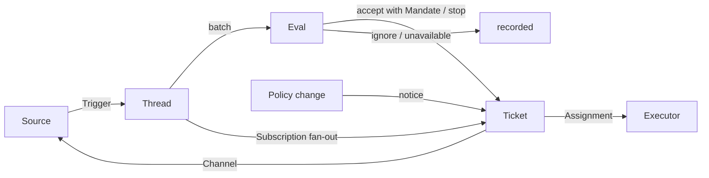

# 001 领域模型

[English](001-domain.md) | 中文

本文定义 dsh-superagent 的概念及各自遵守的规则。代码、agent（智能体）调用的工具、面板和其他文档只使用这些术语。遵循 [000 理念](000-philosophy.zh.md)，模型只保留工作所需的概念，业务需求成为已有概念的属性。

## 流程

工作从触发进入评估，再进入执行。来源产生触发。触发作为上下文扇出到订阅其线程的工单。通过这种方式到达工单的人工消息归该工单处理；其他触发进入评估，判断是否请求新工作。评估接单时创建工单及授权。派工将工单交给执行器，结果通过渠道返回来源。

## 概念

来源、线程、评估、授权和订阅构成核心领域，其余概念为它们提供支持。

| 概念 | 定义 | 遵守的规则 | 存在的原因 |
| --- | --- | --- | --- |
| 来源 | 事件流。来源类型是可复用的实现；来源实例是该类型的一份配置，决定是否运行及监听什么 | 保存读取位置及自身机器人身份。定义哪些内容属于事件，包括只有经过一段时间才成立的条件。在进入领域前丢弃机器人的自身消息和监听范围外的触发。将每个触发转换为所属线程及用于回复的渠道地址 | 重启不得重复处理事件 |
| 触发 | 来源中的一个不可变事件，带有来源自身的元数据，例如行为者 | 属于一个或多个线程。同一触发接单两次也只创建一个工单 | 审计和幂等性的单位 |
| 线程 | 按时间排序的触发；来源定义哪些触发构成一个线程 | 同时最多运行一个评估。可以有多个工单。保存订阅、正在运行的评估和决定历史 | 为评估提供一致的视图及上下文 |
| 关联 | 同一触发所属的多个线程之间的关系 | 只增加上下文，不进行路由 | 让评估跟踪相关证据 |
| 渠道 | 线程的写入侧；来源定义其地址 | 一个线程可以有多个渠道；工单保存一组渠道 | 确认、回复、PR 和解决评审都属于写入 |
| 策略 | 带版本的研判规则及各来源的策略部分：谁可通过该来源发起工作，使用该来源自身的身份，名单如何同步，以及哪些机器人可产生候选项 | 策略版本涵盖规则、接单模式及来源策略部分。影响进行中工单的变更，例如接单所依据的规则变更，会送达其派工，不撤销授权。不同来源的身份从不互相映射 | 规则变更时，正在运行的评估必须作废 |
| 评估 | 对一批触发的判断，分为准入和研判两层 | 输入为触发批次、线程快照、线程中的所有工单（包括已结束工单）及当前策略。输出为决定。不持有状态 | 决定新工作是否启动、继续或停止 |
| 授权 | 接单授予的内容：策略版本、范围、强度、匹配规则、发送者在该来源中的身份，以及来源如何接收到触发 | 不可变；扩大范围需新建工单。工单结束不终止授权：只有人工停止会收回授权，不再支持该授权的策略会撤销它。已结束工单恢复前，按当前策略重新验证 | 说明工作为何获准，以及可以做到哪一步 |
| 工单 | 获得授权的一项工作 | 只有评估可以创建。引用授权；保存渠道和输入。状态从 open → ended；除非被人工停止，否则线程中的人工消息可使其恢复为 open。自定义状态，不跟随执行器状态 | 拥有执行过程及其报告 |
| 派工 | 工单与一个执行器实例的绑定 | 一个工单随时间可有多个派工。独立于工单按 pending → running → ended 变化。执行器侧只有最终报告可以结束工单 | 执行器在领域之外，但执行者的归属必须在领域之内 |
| 订阅 | 工单与线程之间的多对多关系，由线程保存 | 匹配的触发作为上下文扇出给每个仍在进行中的订阅工单，不检查发送者；通过这种方式到达工单的人工消息不经过评估。执行器为获取上下文而关注的线程也以同样方式送达，但不授予权限，也不恢复工单。已结束工单保留订阅，包括已关闭或合并 PR 的订阅：人工消息在同一授权下恢复工单，不产生评估或决定；机器人和 CI 消息不送达，因为执行器恢复时会重新读取线程。人工停止的工单不再接收任何内容。主会话只在消息明确指向已有工单时，将线程附加到该工单。人可以移除线程上的所有订阅；执行器只能移除自身工单对无关线程的订阅，但不得移除工单起始线程，或来源要求其关注的线程，例如其 PR 的线程 | 后续讨论无需再次提及 agent，也能送达执行器 |

人不是领域概念。触发携带来源提供的行为者标识。允许名单属于来源的策略部分，使用该来源的身份。同一个人在多个来源拥有账号这一事实，属于 agent 需要时读取的提示词。

执行器及其会话和目录在领域之外，通过派工连接。

聚合：来源保存读取位置。线程保存订阅、正在运行的评估及决定历史；评估串行运行，期间到达的触发合并到下一批。工单保存派工、渠道和输入，通过 id 引用决定。

## 未采用的概念

| 未采用项 | 原因 |
| --- | --- |
| 将 Principal 或 Membership 作为实体，或映射跨来源身份 | 人属于触发元数据；允许名单属于来源的策略部分；跨来源映射属于提示词 |
| 评估自行安排延迟触发 | 需要等待的条件属于普通来源，因此评估不会反向依赖来源 |
| 等待中或已撤销的评估状态 | 等待属于来源；评估超时后将触发重新入队，或以 `unavailable` 结束 |
| 每个线程最多一个进行中工单 | 一个线程可以承载多项独立工作；研判根据工单列表避免重复 |
| 「追加到工单」决定 | 追加由订阅扇出完成，无需评估 |
| 对订阅进行准入检查 | 订阅覆盖整个线程；授权将权限与上下文分开 |
| 执行路由的关联 | 订阅负责路由；关联只增加上下文 |
| 跟随 DSH 会话的工单状态 | 工单可以移交、恢复或由多个执行器运行，因此自定义状态 |
| 执行器声明人要求其停止 | 只有评估可以决定结束的强度 |
| 策略变更时取消运行中的工单 | 取消会留下未完成的改动；因此改为记录并送达变更 |
| 执行器会话失败或受阻时锁定其所有工具 | 这会拒绝人在会话中直接工作，也会阻止恢复后的报告；暂停自动输入已经足够 |
| 从报告的自由文本推断「等待人工」 | 分类需要结构化事实；执行器通过结构化字段提问 |

## 可复用部分

上述概念及规则可复用。来源实现、策略内容、执行器和渠道实现属于具体部署。各来源内部保留消息、聊天、通知等自身术语，再将它们转换为触发。

| 部分 | 本仓库中的实现 |
| --- | --- |
| 来源 | 飞书：实时事件、历史恢复、订阅话题轮询。GitHub：通知、订阅的 Issue 和 PR、CI 变化、PR 合并或关闭；开启相应开关后，还包括仓库中的所有新 Issue、PR、评论及默认分支 CI |
| 策略 | 研判规则，以及各来源的允许名单、同步、机器人名单和准入表 |
| 执行器 | 每个工单一个 DSH 执行器会话及一个目录，运行于执行器和来源注册变量的执行环境中 |
| 渠道 | 飞书话题回复、GitHub 评论和评审线程回复 |

## 术语表

这里列出本文及后续文档使用的术语和中文名称；尚未介绍的术语由后续文档解释。面板每次显示一种语言，其 (?) 按钮打开双语术语表。agent 在 GitHub 和飞书上发给人的消息使用普通语言，不使用这些术语。

| 术语 | 中文 | 含义 |
| --- | --- | --- |
| Agent | 智能体 | dsh-superagent 运行的自动化团队成员，使用 GitHub 账号、飞书机器人等身份在来源中行动 |
| Main Session | 主 Session | 评估触发、接单并派发工单和回复的 DSH 会话；代码和提示词中称为 `orchestrator` |
| Executor Session | 执行器 Session | 执行器为一个工单运行的 DSH 会话；代码和提示词中称为 `worker` |
| Source | 来源 | 事件流：插件提供的类型及一份实例配置 |
| Trigger | 触发 | 来源中的一个不可变事件 |
| Thread | 线程 | 按时间排序的触发；评估在此单位内逐个运行 |
| Correlation | 关联 | 共享同一触发的线程之间的关系；只增加上下文 |
| Channel | 渠道 | 线程的写入侧 |
| Policy | 策略 | 带版本的接单规则及各来源的策略部分，例如谁可在那里请求工作 |
| Policy version | 策略版本 | 规则、来源策略部分和接单模式的一种组合的标识；每个授权都会记录 |
| Eval | 评估 | 将一批触发转为决定的过程 |
| Gate | 准入 | 评估的确定性第一层：谁可发起工作，以及具有什么强度 |
| Assessment | 研判 | 模型在评估期间作出的判断 |
| Decision | 决定 | 评估的结果 |
| Mandate | 授权 | 接单授予的内容：强度、范围及所依据的策略版本 |
| Ticket | 工单 | 获得授权的一项工作 |
| Assignment | 派工 | 工单与一个执行器实例的绑定 |
| Subscription | 订阅 | 工单与线程之间的关系 |
| Fan-out | 扇出 | 将已订阅线程的触发送达工单作为上下文 |
| Executor | 执行器 | 运行派工的端口：每个工单一个执行器会话及一个目录 |
| Execution environment | 执行环境 | 执行器会话和准备命令的运行环境：执行器和来源注册的变量，每项包含键、值和说明 |
| Report | 报告 | 派工向工单报告的状态 |
| Attention | 待人工决定 | 工单中等待人工回答的问题 |
| Disposition | 去向 | 触发被过滤、评估或扇出的记录 |
| Input | 输入 | 送达工单的上下文：扇出的触发、策略变更、恢复和文本 |
| Scope | 范围 | 授权允许的工作 |
| Strength | 强度 | 授权或评估的依据强度 |

| 分组 | 值 |
| --- | --- |
| Decision | accept 接单 · stop 停止 · ignore 忽略 · unavailable 未完成 |
| Strength | explicit 明确 · inferred 推断 |
| Assignment | pending 待启动 · running 执行中 · ended 已结束 |
| Report | progress 进展 · waiting 等待 · ready 就绪 · blocked 受阻 · failed 失败 · dropped 无需处理 |
