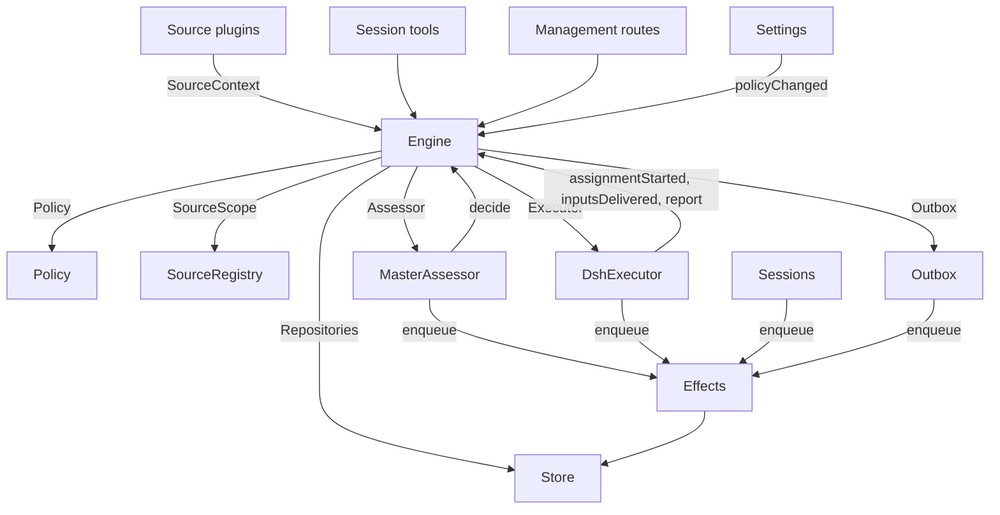

# 007 架构

[English](007-architecture.md) | 中文

本文是实现的开发者指南，将 [001 领域模型](001-domain.zh.md)至 [006 部署](006-deployment.zh.md)中的概念映射到类、接口和文件。先阅读运行时和 Engine，再将模块及测试表用作代码索引。

## 核心类与连接代码

核心类通过小接口拥有领域概念及外部边界。连接代码将工具参数、HTTP 请求、来源载荷和 DeepSeek Harness 事件转换为对这些类的调用，再将结果转为卡片、视图和消息。

`Runtime`（`src/app/runtime.ts`）构建应用、提供依赖，并负责启动和关闭。`Engine` 构建自身内部组件。执行器和研判器会回调 Engine，因此 Runtime 为它们提供 getter，避免构造顺序形成循环。

### Runtime

`Runtime` 是组合根，不包含领域规则。构造器锁定状态目录、打开 Store 并构建各组件。构造失败时关闭 Store 并释放锁。

启动注册管理路由并运行 Setup。设置完成后安装会话及执行器钩子，确保主会话存在，启动策略同步，恢复中断的派工，并启动处理循环及副作用。`ready` 表示启动完成。

关闭取消轮次，等待处理循环、副作用及 agent（智能体），恢复进程环境，关闭 Store 并释放锁。来源插件通过窄接口 `SourceHost` 注入 Runtime，服务名为 `orchestrator`。

| 部分 | 模块 | 职责 |
| --- | --- | --- |
| Setup | `src/app/setup.ts` | 按 worker shell 的运行方式探测 CLI，解析仓库及账号，写入并应用 worker 环境及命令包装脚本，保留设置问题；Settings 通过它检查账号变更并重启，重启会再次运行设置检查 |
| Passes | `src/app/passes.ts` | 每两秒及命令要求时处理一次，同一时间只运行一次：先处理到期副作用，再调用 `Engine.evaluateDue`；来源触发通过它到达 Engine |
| Outbox | `src/app/outbox.ts` | Engine 的 `Outbox` 端口，也是回执的唯一写入者：`send` 在一个事务中保存消息回执并将 `reply` 副作用入队，处理器通过 `SourceRegistry.send` 发送；来源关闭时消息等待，对话消失或不再被监听时丢弃 |
| Notices | `src/app/notices.ts` | 将领域事件及 worker 活动转换为主会话消息。`eventNotice` 处理领域通知；`reportRelay` 立即转发问题，将普通进展保留在工单上，并转发其他报告；`followupRelay` 指明拥有人工后续消息的工单。轮次中到达的转发消息通过 DeepSeek Harness 收件箱在下一步骤一起投递 |

### Engine

`Engine`（`src/core/engine.ts`）是触发、线程、决定、工单及派工的唯一写入者。它从 `src/core/ports.ts` 接收以下端口：`Repositories`、当前策略 getter、`SourceScope`、`Assessor`、`Executor` 和 `Outbox`。可选依赖为 `prepareTicket`、`now` 和 `emit`。

所有 Engine 方法同步执行。每个命令在一个事务中修改其聚合。`evaluateDue` 对每个修改的评估或工单分别使用事务。端口在事务中将外部工作入队；适配器在提交后执行。无效请求抛出 `UserError`。

Engine 提供统一入口并委托给五个内部组件，负责每个命令的事务。`attach`、`evaluateDue` 和 `policyChanged` 等跨组件命令按顺序调用各组件。

每个组件继承 `EnginePart`（`src/core/part.ts`），获得选项及共享读取。组件依赖单向流动：

| 组件 | 职责 | 依赖 |
| --- | --- | --- |
| `Intake` | 来源触发：连同去向只存储一次，记录到线程及其关联，扇出给订阅工单；除已到达工单的人工消息外，在主线程上排队等待评估 | Tickets |
| `Evals` | 线程评估：批处理；准入强度、行为者和依据及提供它们的触发（`primary`）；候选项投递起算的截止时间及暂停造成的顺延；超时评估重新入队；候选项、回放及退回；策略变更后的重新入队；以及每次评估结束的决定：接单、停止、忽略或未完成 | Tickets |
| `Tickets` | 工单生命周期：从接单创建授权、订阅和首次派工；关注的线程及其关闭（`followsDone`）；附加线程和仅用于上下文关注的线程；输入及说明；恢复及恢复时拒绝的消息；重试、重启、停止和结束；移除订阅；向受影响工单通知策略变更 | Replies |
| `Assignments` | 执行器及 worker 的报告：派工已启动、输入送达或未能送达、重启中断，以及 worker 报告及其人工问题 | Tickets、Replies |
| `Replies` | 通过 `Outbox` 写入渠道：按允许各类消息的规则发送确认、回答、结果和待人工决定消息 | 无 |

命令使用 `stopTicket` 等祈使名称；适配器报告的事实使用 `assignmentStarted` 等过去时名称。查询 `candidate` 使用名词。

调用者只获得其角色对应的 Engine `Pick`：`EngineForSources`、`EngineForMainSession`、`EngineForPeople`、`EngineForSettings` 或 `EngineForExecutor`。

| 角色 | 方法 | 效果 |
| --- | --- | --- |
| 来源 | `receive(trigger)` | 只存储一次触发，返回 `stored`、`duplicate`，或在没有来源接收时返回 `filtered`；扇出到订阅其线程的工单，人工消息立即恢复已结束工单，除非处理暂停；在主线程排队等待评估，但已到达工单的人工消息仍归该工单 |
| 来源 | `bindThread(ticketId, thread, own)` | 让未结束工单关注来源线程，例如 PR 的线程；工单创建该 PR 时标记 `own`。已关闭线程重新绑定后再次打开。由线程关闭而非 `ready` 报告结束工单 |
| 来源 | `threadClosed(thread, outcome, at)` | 线程已关闭：关注它的各未结束工单记录关闭，满足关注线程完成规则（`followsDone`）后结束：工单创建的线程均已关闭，或未创建线程时所有关注线程均已关闭。按最近关闭结果结束为 `merged` 或 `closed`，但关闭后恢复的工作尚未报告 `ready`，或执行器在最近非 `progress` 报告或最近轮次结束后，通过确认或回答接手其负责的人工后续消息时除外；之后的 `dropped` 报告按关闭结果结束工单 |
| 主会话 | `candidate(triggerId)` | 持有触发的评估，内容与研判器看到的一致 |
| 主会话 | `candidateDelivered(evalId)` | 评估候选项到达主会话：截止时间从现在起算 |
| 主会话 | `decide(triggerId, outcome)` | 记录评估决定，或明确请求的直接决定。接单原子创建工单、授权、派工、订阅和确认。直接根据卡片忽略的推断候选项在给定原因前记录 `ignoredFromCard`。`followupOwners` 仍拥有人工后续消息时，只允许停止 |
| 主会话 | `attach(ticketId, triggerId, note?)` | 将触发路由到其明确指向的工单，由执行器作为后续消息判断；结束持有触发的评估，其他触发等待新评估。除非处理暂停，否则已结束工单立即在原授权下恢复。执行器仍负责判断的后续消息会被拒绝；路由回已退回该消息的工单也被拒绝 |
| 主会话 | `requestStatus(ticketId)` | 向等待中的执行器会话请求状态，返回是否已请求 |
| 主会话 | `note(ticketId, text)` | 以文本输入向工单执行器提供其他工作的事实，不授予权限 |
| 主会话、执行器 | `reply(request)` | 按用途将消息入队发送到渠道：`acknowledgement`、`answer`、`result` 或 `attention` |
| 人 | `stopTicket(ticketId, reason?)` | 人工停止，收回授权 |
| 人 | `retryTicket(ticketId)` | 结束停滞派工并启动新派工；适用于 `failed` 或 `blocked` 报告后等待人工，或输入投递失败的工单（`canRetry`） |
| 人 | `reevaluate(triggerId)` | 将已存触发入队，重新评估 |
| 人 | `unsubscribe(thread)` | 移除线程上的全部订阅，工单不再关注该线程；各工单仍判断此前在那里收到的后续消息 |
| 人 | `dismiss(decisionId)` | 忽略处理 `unavailable` 决定显示的问题，并记录在决定中 |
| 执行器 | `assignmentStarted(ticketId, assignmentId)` | 派工开始运行；投递其等待输入 |
| 执行器 | `inputsDelivered(ticketId, assignmentId, inputIds)` | 输入到达派工的执行器会话，各自等待步骤接收 |
| 执行器 | `inputsRead(ticketId, inputIds)` | 执行器会话将承载这些输入的消息写入历史（`user/message` 会话事件），模型由此获得它们；步骤已认领，但此前被取消或失败的不算。后续报告或轮次结束后，各输入算已读，重启后也适用，工单结束不释放它们；读取记录启用前投递的输入，在投递后出现报告或轮次结束时算已读 |
| 执行器 | `turnEnded(ticketId, assignmentId)` | 执行器会话轮次结束，包括报告后；须没有后台工作，或正在交给人工处理。此前步骤接收的内容视为已读（`inputsRead`） |
| 执行器 | `deliveryFailed(ticketId, assignmentId, error)` | 输入投递失败；工单显示错误，直到投递成功、新派工开始或工单结束 |
| 执行器 | `report(ticketId, report)` | 记录报告及人工问题；`dropped` 结束工单；`ready` 完成不关注线程的工单，并按关注线程的结束结果结束已满足线程完成条件的工单 |
| 执行器 | `markUnrelated(ticketId, thread, reason)` | 只移除该工单对已附加但无关线程的订阅，并按给定原因退回工单在该线程中负责判断的后续消息 |
| 执行器 | `followForContext(ticketId, thread)` | 未结束工单订阅相关线程获取上下文：消息到达工单，但不提供后续消息强度，也不恢复工单 |
| 执行器 | `handback(ticketId, triggerId, reason)` | 记录工单退回已到达的触发及候选项携带的原因；若该工单原本负责判断，且没有其他工单负责判断，则触发进入新评估队列。返回是否入队。工单对每个触发只退回一次，并保留订阅 |
| 执行器 | `assignmentInterrupted(ticketId, assignmentId)` | 宿主停止时派工仍运行：工作中途被中断，或最新报告后收到输入的派工，像重试一样带恢复说明及已投递但执行器会话未接收的输入重新启动；此后已报告的派工保留会话。DshExecutor 在启动时（`resume`）按最早工单优先报告各项，并重新将等待启动入队 |
| Passes | `evaluateDue()` | 处理未暂停时：为有排队触发的线程启动评估，每线程一个，期间排队的触发合成一批；超时评估的触发连续两次重新入队，第三次记录为 `unavailable`；人工消息在暂停期间到达的已结束工单，授权仍有效时恢复。候选项尚未到达主会话的评估不会超时。暂停期间评估不超时，恢复后各截止时间按暂停时长顺延 |
| Settings | `policyChanged(from, to, effects)` | 告知各受影响的进行中工单变更如何影响它（`src/policy.ts` 的 `policyEffects`：接单所依据的规则变更或不再适用、请求者可能无法再发起工作，或不再接受主动工作），并按新版本重启进行中的评估 |

Engine 将批处理、授权、扇出、恢复及待人工决定生命周期规则保持为内部实现。以下共享判定保持规则一致：

- `waitsForPerson`（`src/core/model.ts`）：最新派工报告 `blocked` 或 `failed`，此后没有人工消息到达。此条件成立时，自动输入和失败启动继续暂停。
- `followupOwners`：仍负责自身线程所收到人工后续消息的工单。工单可以在进行中，或已结束但未被人工停止且等待恢复。退回消息结束该归属。
- `settled`：决定已解决请求；停止、未完成、已路由及拒绝停止的决定不算。
- `ticketStage`（`src/core/stage.ts`）：实现 [003 执行](003-execution.zh.md)的阶段表。

工单结束时，未读后续消息返回评估，除非其他工单仍拥有它们，或其他去向已解决它们。已确认、回答和退回的消息除外。旧记录没有确认去向时，发件箱回执提供这一事实。最终报告也涵盖派工开始时等待的消息，包括恢复工单的消息。停止工单的消息不会自动重新评估。

变更后，Engine 发出 `src/core/ports.ts` 中的 `DomainEvents` 事件：

`trigger.received`、`eval.started`、`decision.recorded`、`ticket.created`、`ticket.resumed`、`ticket.ended`、`assignment.started`、`assignment.ended`、`thread.subscribed`、`thread.unsubscribed`、`trigger.requeued` 或 `policy.changed`。

Runtime 将 `ticket.ended`、`trigger.requeued` 和 `thread.unsubscribed` 转为通知。投递到工单的人工 `trigger.received` 成为后续消息转发。工单以合并或关闭结束时，`pullEndNotices` 用稳定 id 发送一次聊天通知。其他事件目前无消费方。

### 模型

`src/core/model.ts` 保存领域类型，`src/core/stage.ts` 保存工单阶段。决定的 `reason` 记录原因，为 `Reason` 列表（`src/core/reasons.ts`）：每项包含 `code`、`values`，以及批次中特定触发的 `triggerId`。

核心代码（例如 `timeout`、`policyChanged`、`routed` 和 `startedTicket`）定义于 `REASONS`，agent 通过 `reasonText` 读取对应英文；准入或来源范围提供自己的代码，例如 `not_a_member`；`said` 保存研判器或人编写的文字。面板通过 `reason.<code>` 表达各代码，来源过滤的触发也以同样方式记录来源代码。

工单只保存每项事实一次。没有 `ended` 时为未结束；该字段记录何时、由谁、为何、以何结果结束。最后报告的内容是最新派工报告（`latestReport`）；执行器会话按工单命名（`src/executor/dsh.ts` 的 `workerSessionId`）。

字段有明确类型：`origin` 包含为评估批次提供强度的获准触发及批次本身（`triggerId`、`triggerIds`）；`execution` 是执行器选择的内容（`name`、`directory` 和 `assignment`）；`delivery` 保存最近输入投递失败（`error`、`at`），直到投递成功、新派工启动或工单结束；`follows` 保存来源要求关注的线程，每项为 `{thread, own, closed?}`，工单创建该线程时标记 `own`，关闭后 `closed` 包含 `at` 和 `outcome`。只有 Tickets 写入 `follows`；GitHub 来源通过 `pullsOf` 和 `pullOf`（`src/sources/github-pull.ts`）读取对应 PR（Pull Request）。

承载触发的输入记录是否由人编写，供 `waitsForPerson` 读取。线程的 `context` 还列出仅为上下文而订阅它的工单，`expired` 统计排队触发的评估连续超时次数；Evaluation 记录 `primary` 触发及候选项 `delivered` 的时间。

触发去向记录通过扇出或附加到达的工单、人工重新入队、各工单的退回及原因，以及执行器已确认或回答它的各工单。

授权的 `basis`（`MandateBasis`）记录准入如何接纳触发。重新验证读取接收 `source`、`scope` 和 `row`，名单中的 `sender`、匹配的 `rules` 及 `via`：

| `via` | 准入依据 |
| --- | --- |
| `addressed` | 允许的发送者直接向 agent 发出消息 |
| `followup` | 消息到达已有工单的线程 |
| `admission` | 准入表单元格；`observation` 标记推断候选项 |
| `bot` | 名单中的机器人产生推断候选项 |

触发和线程的 `meta` 归来源所有，核心不解释其内容。

### 策略

`src/policy.ts` 定义设置 schema、授权及研判规则。`settingsPolicy(settings, scope)` 每次使用都返回新的无状态 `Policy`：

- `version`、`paused` 和 `evalTimeoutMs` 描述当前状态。
- `gate(trigger, thread, tickets)` 返回准入强度及依据。
- `revalidate(mandate)` 检查已有授权是否仍有效。
- `admitsInferred(rules)` 只在自动模式且有启用的匹配规则时允许主动接单。

`assessmentOutcome(assessment, settings, strength)` 将模型研判转为 Engine 结果。它要求判断每条启用规则、明确处理方向、存在匹配规则及意图证据。非自动模式下，推断接单转为「本会接单」记录。

`policyEffects(tickets, old, now, scope)` 确定变更影响哪些未结束工单及如何影响。`Engine.policyChanged` 只通知这些工单。`policyVersion` 对规则、接单模式及来源策略部分计算哈希，包括机器人名单。

### Store

`Store`（`src/app/store.ts`）拥有一个 SQLite 数据库。Runtime 打开它之前获取目录锁，阻止第二个进程迁移或写入同一状态。

接口按用途分组：

- **领域仓储：** `atomic`，以及各具备 `get`、`save` 和列表查询的 `triggers`、`threads`、`tickets`、`decisions`。带索引的工作集合为 `threads.active()`、`tickets.open()`、`tickets.active()` 和 `read.subscribedThreads`。
- **读取查询：** `read` 通过 `threadTriggers`、`triggerStats`、`search` 和 `droppedReplies` 等方法服务于视图、工具及来源轮询。这些方法绝不写入。
- **来源元数据：** `threads.describe` 和 `threads.patchMeta` 更新来源拥有的线程元数据。
- **设置：** `settings`、`saveSettings`、`blockRevision` 和 `settingsHistory`。设置和提示词使用编号的 `Versions`（`src/app/versions.ts`）。
- **发件箱回执：** `replyStatus` 和 `receipts`，只由 Outbox 写入。回执操作为 `get`、`waiting`、`behind`、`add`、`settle` 和 `withdraw`。`behind` 检查同一工单、同一对话是否有较早消息等待且失败不足三次。撤回的消息以 `channelGone` 或 `channelIgnored` 结算。读取查询通过 `failingReplies`、`droppedReplies` 和 `droppedSince` 暴露失败及丢弃回复。
- **带类型的键值记录：** `get`、`set`、`delete` 和 `keys`，使用 `KV` 条目。

`afterCommit` 只在事务提交后运行操作，回滚后绝不运行。Runtime 按存储结构读取记录；schema 11 迁移在启动时转换支持的旧记录。

### 副作用

`Effects`（`src/app/effects.ts`）是持久化副作用队列。命令在事务中调用 `enqueue(kind, key, payload)`；只在提交后开始执行。

每个 kind/key 组合一行。重复入队同一等待键会替换载荷并使其立即到期，不改变队列顺序。`handle(kind, run, options)` 为每类注册一个处理器，按最早优先处理到期行，受并发限制约束。

失败按指数退避重试。抛出 `Later` 延后工作但不计失败，例如没有 worker 名额时。`start` 在设置完成后开始处理；`drain` 在关闭时停止处理并保留待处理行；`pending`/`idle` 暴露队列状态。

| 类型 | 处理器 | 职责 | 同时执行数 | 重试 |
| --- | --- | --- | --- | --- |
| `assessment` | MasterAssessor | 将评估候选卡片以 steering（中途引导）方式送入主会话轮次，再通知 Engine 已投递，开始评估截止时间计时 | 4，暂停时为 0 | 2 秒起翻倍，最多 60 秒 |
| `launch` | DshExecutor | 启动待处理派工：准备命令、执行器会话、派工消息 | 空闲 worker 名额数，暂停时为 0 | 模型提供商或网络暂时故障从 5 秒起翻倍，最多 300 秒，重试三次；其他失败及准备命令失败会使工单失败。因暂停或名额已满而等待时，5 秒后重试 |
| `delivery` | DshExecutor | 按顺序将工单等待输入交给运行中的派工 | 4，暂停时为 0 | 2 秒起翻倍，最多 60 秒；等待 worker 名额时，2 秒后重试 |
| `relay` | Sessions | 将 worker 报告或问题、人工后续消息引导到主会话轮次 | 1，按队列顺序 | 2 秒起翻倍，最多 60 秒 |
| `notice` | Sessions | 向主会话注入通知，不唤醒会话 | 1，按队列顺序 | 2 秒起翻倍，最多 60 秒 |
| `reply` | Outbox | 通过来源向渠道发送消息，等待同一工单、同一对话中失败不足三次的较早消息；撤回会取消发送 | 1，暂停时为 0 | 5 秒起翻倍，最多 300 秒；来源关闭或等待较早消息时，5 秒后重试 |

各类型以其名称拥有健康项。某个副作用连续失败三次后报告错误，`delivery` 除外，其失败显示在对应工单上。转发和通知各自保持顺序；失败项阻挡后续同类项。

### 来源

来源通过 `src/sources/kind.ts` 定义的 `SourceKind` 扩展宿主。类型声明身份、标题、说明、配置 `schema` 和 `fields`、派生 `facts` 及 `health` 条目。可选行为包括 `scope`、`channel`（`allowed`、`send`、`link`）、`threadContext`、`find`、`policy`、`environment` 和 `refreshLabels`。

`SourceRegistry`（`registry.ts`）拥有注册类型及存储实例，实现 Engine 的 `SourceScope`。注册在 `HealthBoard` 上认领健康项；重复认领及保留的 `sync:` 名称会被拒绝。SourceContext 只能写入其注册所认领的条目，因此注销后的报告无效。

注册表配置方法包括 `kind`、`instances`、`instance`、`validate`、`validatePolicy`、`policyPart`、`channelAllowed`、`declarations`、`environments`、`find` 和 `scope`。`find` 向每个支持搜索的类型查询。

通用代码通过注册表访问来源行为。`send(message, commands)` 调用类型的渠道，返回 `sent`、`gone`，或在类型未安装时返回 `waiting`。`link` 解析渠道链接。`threadContext` 将类型读取器与其配置配对；类型无读取器时不返回内容。无效存储配置会禁用实例。

插件接收 `SourceHost`：注册表和 `context(kind)`。类型自身使用更窄的 `SourceContext`，由 `src/app/source-context.ts` 的 `sourceContextOf` 构建。

上下文提供部署及命令、设置就绪状态（`ready`、`configured`、`problem`）、配置、`receive`、`atomic` 和带类型的 `state`。它还提供线程读取和元数据写入、工单读取及绑定／关闭命令、触发读取、通过 Outbox 的 `notify`，以及声明健康项的 `report`。

### DshExecutor

`DshExecutor`（`src/executor/dsh.ts`）为每个工单提供一个会话及目录。`start` 和 `deliver` 将 `launch` 和 `delivery` 副作用入队。`stop` 通过 `Store.afterCommit` 取消轮次，因此回滚的结束不会停止 worker。

`prepare(ticket, outcome)` 提供 Engine 的 `prepareTicket` 钩子：短名称、目录及 `ticketExecution` 派工文本。`workerSessionId(ticket.id)` 推导会话 id。

`WorkerSlots` 在启动或投递唤醒空闲 worker 前预留容量。人工消息可以使用超出 `maxWorkers` 的一个名额，唤醒优先于启动。`activeCount` 提供面板负载。

提供商及网络暂时故障重试三次。启动使用副作用退避；失败轮次在 15、30 和 60 秒后收到继续消息。`inputMessage` 根据当前工单状态渲染各输入，`mandateInstructions` 为推断工作添加匹配规则限制。

`install` 订阅会话事件；`dispose` 取消订阅。轮次结束通常报告等待，但就绪后或需要人工操作时除外。错误报告失败。启动时，`resume` 通过 `assignmentInterrupted` 报告中断派工，并按最早工单优先重新将不等待人工的待启动任务入队。

### MasterAssessor

`MasterAssessor`（`src/app/assessment.ts`）使主会话可以研判主动候选项。`request` 将研判副作用入队；`release` 在评估结束时丢弃缓存状态。

`context`、`read` 和 `decide` 方法服务于 `orchestrator_eval`、`orchestrator_eval_read` 和 `orchestrator_eval_decide`，通过 `SourceRegistry.threadContext` 提供有限线程上下文、仓库上下文及决定提交。没有上下文读取器的类型只提供触发及批次。

`assessmentOutcome` 转换模型回答，供 `Engine.decide` 使用。Evals 再次按当前策略检查推断接单。

### Settings

`Settings`（`src/app/settings.ts`）读取和写入带修订的设置块。`current` 和 `view` 读取；`save(block, value, revision, origin)` 验证保存；`pause(paused, origin)` 修改独立的 `paused` 设置。

每次保存声明来源：`panel`、`tool` 或 `sync`。只有 `panel` 可以改变执行环境及 `SETUP_FIELDS`（`src/deployment.ts`）列出的字段。

策略版本变更计算 `policyEffects`，记录哪些工单已获通知，并调用 `Engine.policyChanged`。`syncable` 和 `sync(id)` 刷新来源策略部分。`refreshLabels(id)` 刷新显示名称。

### 提示词

`Prompts`（`src/app/prompts.ts`）将配置存储为 `Versions`。`current`、`version` 和 `history` 读取；`validate`、`preview` 和 `save(value, baseRevision, source)` 检查并保存；`compose` 和 `skills` 构建会话文本。

`builtInParts` 列出覆盖键、角色、默认文本及必需模板占位符。每项覆盖保存团队 `text` 和 `base`，后者是原始默认值的 `builtInBase` 键。保存将默认值保留在 `KV.prompts.builtIn` 下。`defaultChanged` 随后报告默认值变更、可用时的旧文本及已移除部分。

验证从已保存覆盖继承省略的 base，丢弃已存数据中存在的已移除部分，拒绝空白文本及其他未知键。这使保存工具能够保存它读取的配置。`environmentSection` 和 `policySection` 只使用自身键替换一次模板值。未覆盖的配置使用默认值。

### 会话

`Sessions`（`src/app/sessions.ts`）管理两种角色的 DeepSeek Harness 会话。`ensure` 使用角色模型创建会话。`install` 跟踪 agent 事件，并为托管会话注册提示词、skill（技能）及工具。

`prompt` 每个请求 id 只投递一次。`relay` 和 `notify` 将主会话消息入队，由 `relay` 和 `notice` 副作用处理。`src/app/notices.ts` 定义内容；`delivery` 检查消息是否到达。

每次模型请求将会话绑定到当前提示词修订。使用过的修订持久保存：`promptVersion` 标识当前有效修订，`mayRead` 限制 worker 可查看的版本。每个 agent 的注册由一个 map 跟踪。

`status` 和 `promptVersion` 服务提示词页面。保存通过 `Prompts.save` 并通知主会话。`modelRetry` 暴露模型预算重试状态。

### 连接代码

| 连接代码 | 转换内容 |
| --- | --- |
| `src/app/runtime.ts` | 组合根：按各组件使用的接口构建组件，注册路由及来源宿主，启动和停止 dsh-superagent |
| `src/app/notices.ts` | 将领域事件和 worker 报告转换为主会话通知及转发消息 |
| `src/app/tools/main.ts`, `src/app/tools/executor.ts` | 将主会话及执行器会话工具参数转为核心类调用，将结果转为卡片 |
| `src/app/http.ts`, `src/app/views/`, `src/app/api.ts` | 将 HTTP 请求转为调用，将 Store 读取转为面板视图；`api.ts` 为面板各路由提供类型 |
| `src/app/resources.ts`, `src/app/links.ts`, `src/app/cards.ts` | 将资源名称转为读取，来源消息转为链接，记录转为模型使用的紧凑卡片 |
| `src/sources/github*.ts`, `src/sources/feishu*.ts`, `src/sources/poll.ts` | 将 GitHub 和飞书载荷转为触发及线程事实，将消息转为 CLI（命令行界面）调用 |
| `src/deployment.ts`, `src/setup.ts`, `src/infra/` | 设置探测及问题、CLI 传输、agent 进程环境 |

## 依赖规则

- **依赖明确且范围小。** 每个类接收明确列出所用能力的接口，主要是其他类的 `Pick` 类型：核心类使用 `ExecutorHost`、`AssessorHost`、`SessionsHost`、`SettingsHost`、`SetupHost`、`PassesHost` 和 `OutboxHost`；连接代码使用 `HttpHost`、`MainToolsHost`、`ExecutorToolsHost`、`ResourceHost`、`LinkHost` 和 `SourceContextDeps`；Engine 则按调用角色提供对应 `Pick`。Runtime 只通过这些接口传递自身。来源插件注入 `orchestrator` 服务，类型名为 `SourceHost`，包含注册表和 `context(kind)`；类型代码只看到自身 `SourceContext`。
- **导入范围。** 除 Node 哈希外，`src/core` 不导入外部内容，也不执行 I/O。`src/sources` 不从 `src/app` 导入。面板只从宿主侧导入类型，以及 `src/admission.ts`、`src/limits.ts`、`src/setup.ts`、`src/navigation.ts`、`src/sources/host.ts`、`src/core/errors.ts`、`src/core/reasons.ts` 的普通值和 `src/app/api.ts` 的筛选列表。
- **每项状态一个写入者。** 各类状态只有一个写入者，其他组件读取或向该写入者请求。

  | 状态 | 写入者 |
  | --- | --- |
  | 触发、线程、决定、工单、派工 | Engine |
  | 来源读取位置及在线程上保存的元数据（`label`、`url`、`facts` 及自身键） | 该来源，通过 `SourceContext` |
  | 设置及其历史 | Settings |
  | 提示词版本 | Prompts |
  | 副作用行 | Effects |
  | 发件箱回执 | Outbox：Engine 消息及来源 `notify` 通过其 `send`，由其 `reply` 副作用标记 |
  | 健康项 | 在 `HealthBoard`（`src/infra/health.ts`）认领该项的组件；重复认领被拒绝：`runtime` 由 Runtime 认领，Passes 通过它报告；`evals` 由 Runtime 每次处理后报告；`models` 由 Sessions；各副作用类型由 Effects；`worker` 由 DshExecutor；来源类型的条目由 SourceRegistry 为该类型来源认领；`sync:<id>` 由 Settings |

  来源只通过调用 Engine 的 `SourceContext.tickets.bindThread` 和 `threadClosed` 修改工单。
- **请求和事实。** 请求某操作的方法用祈使动词及对象命名，例如 `stopTicket` 或 `bindThread`，可以被拒绝；记录适配器已完成操作的方法用过去时命名，例如 `assignmentStarted` 或 `deliveryFailed`。各宿主按所需角色类型接收 Engine。
- **字段有类型，来源数据归来源。** 代码读取工单和授权的带类型字段。来源不在工单上保存数据：工单关注的来源线程保存在工单 `follows` 中，来源对触发或线程保存的内容位于其 `meta`。
- **固定拒绝原因。** 人或 agent 可引发的拒绝是 `src/core/errors.ts` 的 `USER_ERRORS` 中的 `UserError(code, values)`。管理 API 对 `missing` 返回 404，其他代码返回 400；面板以自身语言表达各代码。设置问题使用 `SetupError` 代码（`src/setup.ts`）及固定健康文本 `HealthCode`（`src/sources/host.ts`），采用相同表达方式。
### 来源专属依赖

部分通用模块仍直接引用 GitHub 或飞书：

- Outbox 应用飞书聊天词数限制。
- `src/app/links.ts` 解析飞书消息链接及 `repliedTo`。它和 Runtime 通过 `feishuSettings` 读取设置。
- `src/app/resources.ts` 读取 `feishu/` 和 `github/` 原文；`src/app/cards.ts` 用 `pullOf` 构建工单卡片。
- Runtime 为合并或关闭的工单发送 `pullEndNotices`。
- 执行器工具通过 `readPull` 和 `claimPull` 绑定报告的 PR，使用 Runtime 暴露的 GitHub 上下文。
- MasterAssessor 通过 `readRepositoryPath` 读取仓库文件。
- Sessions 和 Prompts 只为 GitHub 和飞书注册内置 skill。迁移转换它们的 schema-10 记录。
- Setup 只探测 GitHub 和飞书账号字段（`SETUP_FIELDS`）。只有这些来源通过 `SourceContext.problem` 接收账号设置问题。

## 模块

| 路径 | 职责 |
| --- | --- |
| `src/index.ts` | 主插件入口：读取机器设置、启动 Runtime，并提供保存来源账号时使用的重启操作 |
| `src/deployment.ts` | 插件 `Config` 和 `Machine`；`resolveDeployment` 和 `resolveFeishuBot` 从来源设置读取仓库及账号，各 CLI 按执行器 shell 的方式运行；`SETUP_FIELDS` 列出设置检查读取的来源字段。代码不指定任何人、账号或组织 |
| `src/setup.ts` | 设置问题：`SetupError`，包含代码、修复位置及日志、主会话和面板共享的英文文本 |
| `src/policy.ts` | 策略：各配置块的设置 schema、策略版本、准入及授权重新验证 |
| `src/admission.ts` | 准入表的值、各单元格选项及默认值，与面板共享 |
| `src/limits.ts` | 用户设置值的限制，由设置 schema 检查，并供面板字段使用 |
| `src/kv.ts` | `KV`：各 `kv` 记录族及其键、值类型和拥有者，以及 Store 和 `SourceContext.state` 使用的 `Key` 和 `Family` 类型 |
| `src/navigation.ts` | 宿主目录列出会话后，从面板打开 DeepSeek Harness 会话 |
| `src/core/model.ts` | 领域类型，包括带类型的工单和 `MandateBasis`，以及 `threadKey`、`ticketOutcome`、`reached`、`followupOwners`、`settled`、`waitsForPerson`、`liveTicket`、`runningAssignment`、`latestAssignment` 和 `latestReport` |
| `src/core/ports.ts` | 端口：`Repositories`、`Policy`、`SourceScope`、`Assessor`、`Executor`、`Outbox`，以及领域事件 |
| `src/core/engine.ts` | Engine，核心入口，以及角色接口 `EngineForSources`、`EngineForMainSession`、`EngineForPeople`、`EngineForSettings` 和 `EngineForExecutor` |
| `src/core/part.ts` | Engine 组件的基类 `EnginePart`，以及 `EngineOptions` |
| `src/core/intake.ts` | `Intake`：将来源触发送达工单；除到达工单的人工消息外，还送往评估 |
| `src/core/evals.ts` | `Evals`：线程评估及决定 |
| `src/core/tickets.ts` | `Tickets`：工单生命周期、关注线程、订阅及输入 |
| `src/core/assignments.ts` | `Assignments`：执行器事实及 worker 报告 |
| `src/core/replies.ts` | `Replies`：Engine 的渠道写入 |
| `src/core/stage.ts` | `ticketStage` 和 `canRetry`：[003 执行](003-execution.zh.md)中的工单阶段 |
| `src/core/errors.ts` | `UserError` 和 `USER_ERRORS` |
| `src/core/reasons.ts` | `Reason`、`REASONS` 和 `reasonText`：核心按代码记录决定或搁置触发的原因 |
| `src/core/ids.ts` | `key`：从输入推导 id，相同输入产生相同 id |
| `src/core/memory.ts` | `MemoryRepositories`：Store 仓储的内存版本，保持 Store 顺序及嵌套回滚，供领域测试使用 |
| `src/core/index.ts` | 核心导出 |
| `src/app/runtime.ts` | Runtime，组合根，以及启动和停止 |
| `src/app/setup.ts` | Setup，以及判断保存是否改变设置检查读取字段的 `setupChanged` |
| `src/app/passes.ts` | Passes，处理调度器 |
| `src/app/outbox.ts` | Outbox：Engine 的 `Outbox` 端口、回执及发送它们的 `reply` 副作用 |
| `src/app/notices.ts` | 主会话通知及转发：`eventNotice`、`reportRelay`、`resultRelay` 和 `followupRelay` |
| `src/app/store.ts` | Store，以及发件箱消息 `Receipt` |
| `src/app/store-read.ts` | `storeReads`：供视图、工具及来源轮询使用的 Store 只读查询，绝不写入 |
| `src/app/migration.ts` | schema 11 迁移：从 schema 10 单步迁移，将所有存储记录写为当前结构 |
| `src/app/effects.ts` | Effects |
| `src/app/versions.ts` | `Versions`：以编号快照保存的记录，带当前版本指针，用于设置和提示词 |
| `src/app/cache.ts` | `TextCache`：在大小限制内缓存文本，优先丢弃最近最少使用的文本 |
| `src/app/settings.ts` | Settings |
| `src/app/settings-history.ts` | `policyHistory`：各已保存设置修订及相对前一修订的变化 |
| `src/app/prompts.ts` | Prompts、团队可覆盖的内置部分 `builtInParts`，以及角色提示词部分顺序 `promptParts` |
| `src/app/context.ts` | 从 `prompts/` 读取的内置提示词文本，以及会话读取的 transcript（文本记录）条目 |
| `src/app/skill-files.ts` | 随包文本：将文件中一句一行的文本合并为段落的 `promptFile`，以及随包 skill |
| `src/app/sessions.ts` | Sessions |
| `src/app/delivery.ts` | `AgentDelivery`：每个请求 id 向 DeepSeek Harness agent 只投递一次消息，恢复会话后也保持 |
| `src/app/retry-health.ts` | `RetryHealth`：为 `models` 健康项统计等待模型预算重试的会话 |
| `src/app/role-models.ts` | 解析评估及执行器模型，并为新会话设置角色模型 |
| `src/app/assessment.ts` | MasterAssessor、研判 schema 及 `orchestrator_eval` 返回的窗口 |
| `src/app/execution-environment.ts` | 执行环境：变量、工单专属值、目录根路径及提示词部分各行，由 `src/app/prompts.ts` 填入模板 |
| `src/app/source-context.ts` | `sourceContextOf`：各来源类型的 `SourceContext` |
| `src/app/links.ts` | `sourceLink`，触发消息所在页，以及 `candidateCard` |
| `src/app/cards.ts` | 模型使用的触发、工单、线程及决定紧凑卡片，工单卡片状态的封闭集合 `TICKET_STATES`，以及 `textPage` |
| `src/app/resources.ts` | `RESOURCES` 和 `readResource`：各角色的 `orchestrator_read` 读取内容 |
| `src/app/tools/tool.ts` | `Tool` 类型、`readTool`、两种角色的 `orchestrator_read`，以及 `AcknowledgementSchema` |
| `src/app/tools/main.ts` | 主会话工具 |
| `src/app/tools/executor.ts` | 执行器会话工具 |
| `src/app/http.ts` | `/orchestrator/api` 路由：同源检查、请求限制及各类失败的状态码 |
| `src/app/api.ts` | `Api`，包含各路由参数、查询、请求体、响应及列表筛选项；只导入类型，因此可由面板打包 |
| `src/app/views/text.ts` | 视图文本的两种形式：单行纯文本 `preview` 和不含 HTML 的 `markdown`；以及 `plain` 和 `readable` |
| `src/app/views/records.ts` | 视图共享行：触发、工单、线程、决定及渠道链接；`ownersOf` 给出一次请求所读取的后续消息拥有者 |
| `src/app/views/tickets.ts` | 按阶段排列的工单列表、工单页面、授权依据事实及执行器负载 |
| `src/app/views/threads.ts` | 线程列表、线程时间线、搜索及决定列表 |
| `src/app/views/sources.ts` | 来源状态：各实例状态、最近一天计数，以及当天过滤和丢弃的内容 |
| `src/app/views/settings.ts` | 设置页视图：各块及修订、各来源设置及类型表单、执行环境 |
| `src/app/views/overview.ts` | 概览：需要人的工单、问题、最近一天流程及执行器负载 |
| `src/executor/dsh.ts` | DshExecutor、`WorkerSlots`、`ticketExecution`、`inputMessage` 和 `mandateInstructions` |
| `src/executor/background.ts` | worker 在 DeepSeek Harness 中的后台工作、会话拥有的 shell 任务（`ctx.jobs`）及 subagent（`ctx.subagents`）：`runningJobs`、`untilQuiet`、`killJobs`、`collectJobs`、`stopSubagents`、`stopBackground`、`until`，以及 `cancelled`，即因 subagent 停止而取消轮次的 worker |
| `src/infra/commands.ts` | `Commands`，CLI 传输：`run`；限制于配置仓库并经过验证的 `api` 和 `pages`；以机器人身份运行的 `lark`；`git`。`CliError` 携带命令输出中的代码，例如 GitHub HTTP 状态；无输出命令失败时只报告结束方式，不报告参数；`validItems` 跳过并统计列表格式错误项 |
| `src/infra/environment.ts` | agent 进程环境：命令包装脚本、Git 配置和凭据助手、`runAsWorker`，以及环境及工单目录检查 |
| `src/infra/paths.ts` | 包根目录，即随包文件所在位置 |
| `src/infra/text.ts` | 词数统计及聊天消息限制、`fill` 和 `sameName` |
| `src/infra/health.ts` | `HealthBoard`，各部分健康项，由各自唯一写入者认领 |
| `src/sources/kind.ts` | `SourceKind` 协议 |
| `src/sources/registry.ts` | `SourceRegistry` |
| `src/sources/host.ts` | `SourceHost`、`SourceContext`、`Health`、`health` 及固定健康文本 |
| `src/sources/poll.ts` | GitHub 和飞书轮询共享内容：`POLL_HORIZON_MS`、`polled`、`cursorAt` 和 `pollThreads`，后者将线程失败保留为 `pollError` |
| `src/sources/github.ts` | GitHub 类型及插件入口，导出为 `./github-watch`：每轮轮询通知、未结束工单的 PR 及 CI、订阅线程 |
| `src/sources/github-trigger.ts` | 将 GitHub 评论、评审、Issue 正文及 CI 变化转换为触发，以及 GitHub 地址 |
| `src/sources/github-pull.ts` | PR 规则：工单关注哪些 PR（`claimPull`、`observePull`）、向 Engine 报告关闭，以及 `pullEndNotices`，即工单合并或关闭结束后的聊天通知 |
| `src/sources/github-channel.ts` | GitHub 渠道：评论及评审线程回复，返回 `sent` 或 `gone` |
| `src/sources/github-read.ts` | CI 快照、仓库读取、`github/` 资源及 `githubThreadContext`，即按页读取 Issue 或 PR 对话 |
| `src/sources/feishu.ts` | 飞书类型及插件入口，导出为 `./feishu-watch` |
| `src/sources/feishu-trigger.ts` | 将飞书消息转换为触发，实时事件、历史页及话题页使用统一规则 |
| `src/sources/feishu-loops.ts` | 飞书循环：事件消费、历史恢复、群名称及订阅话题轮询 |
| `src/sources/feishu-channel.ts` | 飞书渠道：话题回复，返回 `sent` 或 `gone` |
| `src/sources/feishu-read.ts` | `feishu/` 读取触发消息、根消息、父消息及话题；`feishuThreadContext` 将这些内容及图片提供给研判 |
| `src/sources/admission-context.ts` | 研判起始的有限窗口：通过类型读取触发线程的首页，以及触发周围消息 |
| `src/sources/feishu-image.ts` | 将飞书消息图片读取为研判会话的附件 |
| `src/client/index.tsx` | 客户端插件入口：侧栏入口、主面板及 DeepSeek Harness 插件管理器页面 |
| `src/client/app.tsx` | 面板：页头、搜索、术语表、标签页及当前路由页面 |
| `src/client/provider.tsx` | 各页面从宿主读取的内容：文案、调用、导航、通知、状态轮询及 `restart`，后者在 dsh-superagent 重启时快速读取状态 |
| `src/client/api.ts` | 管理 API 调用及轮询，类型来自 `src/app/api.ts`，以及评估状态的决定筛选项 |
| `src/client/route.ts` | 标签页、设置分组、`parseRoute` 读取的带类型路由，以及包含最后打开设置组的路由记忆 |
| `src/client/overview.tsx` | 概览 |
| `src/client/source.tsx`, `trigger.tsx`, `eval.tsx`, `execution.tsx` | 每阶段一个文件：状态，以及存在时的阶段设置 |
| `src/client/thread.tsx`, `ticket.tsx` | 记录页面：线程及时间线，工单及授权、输入和派工 |
| `src/client/settings.tsx` | 设置标签页：分组导航及当前显示组 |
| `src/client/settings-kit.tsx` | 设置块组件：阶段组共享设置、`useBlockDraft`、字段（包括来源类型字段）及保存历史 |
| `src/client/prompts.tsx` | 提示词设置：页面拥有读取的视图，编辑器拥有草稿，编辑、完整提示词和历史标签页据此渲染；内置部分编辑器显示默认值变更，并保留或移除覆盖 |
| `src/client/prompt-config.ts` | 按团队部分、skill 名、内置部分（`part/<key>`，带 `withOverride`）及提示词视图给出的部分标题组织提示词配置，以及完整提示词逐行差异，均为纯函数 |
| `src/client/deployment.tsx` | 部署设置，也在 DeepSeek Harness 插件管理器中显示 |
| `src/client/draft.tsx` | 设置草稿：`draftReducer`、状态及与较新保存修订的合并、保存栏文本 `saveBarText`，以及保存栏 |
| `src/client/controls.tsx` | DeepSeek Harness 控件的本地副本，沿用其标记、键盘行为及设计 token，因为组合包不导入 `@deepseek-ai/dsh-client-ui-primitives`；这些控件不读取上下文 |
| `src/client/widgets.tsx` | 页面共享且读取面板上下文的小组件：分节、页头、加载状态、时间、链接、确认操作、设置检查及 Markdown |
| `src/client/rows.tsx` | 页面共享行：工单、线程和决定、线程标签，以及自动消息连续段的折叠 |
| `src/client/markdown.ts` | 报告和问题支持的 Markdown 子集，以及消息中的裸地址，表示为块及行内部分 |
| `src/client/text.ts` | 按键索引的文案，以及领域值、原因、发送者和时间的表达 |
| `src/client/marks.ts` | 视图分类状态的标记：工单或线程阶段、来源状态、决定结果，各包含圆点、图标、色调和标签 |
| `src/client/locales.ts` | 全部双语文案及 [001 领域模型](001-domain.zh.md)的术语表 |
| `src/client/client.css`, `css.d.ts` | 面板样式表，以文本加载 |

`src/sources/github.ts` 和 `src/sources/feishu.ts` 也是两个来源插件的入口，由 `tsdown.config.ts` 构建，在 `package.json` 中导出为 `./github-watch` 和 `./feishu-watch`。组合包 `cordis.patch.yml` 插入三个插件，其中飞书默认禁用。

## 测试

| 测试 | 覆盖范围 |
| --- | --- |
| `tests/core-engine.spec.ts` | 内存仓储上的领域规则：接收、评估、扇出、恢复和停止、中断派工、暂停、策略变更、报告和结果、附加、回复、投递失败及问题忽略处理 |
| `tests/stage.spec.ts` | 逐行覆盖工单阶段 |
| `tests/policy.spec.ts` | 来源范围、准入、准入表、授权重新验证、策略版本、设置迁移及研判结果 |
| `tests/registry.spec.ts` | `SourceRegistry`：实例、验证、策略部分、渠道及线程上下文 |
| `tests/sources.spec.ts` | `SourceContext` 上的飞书和 GitHub 来源：转换、轮询及读取位置、PR 规则、健康 |
| `tests/commands.spec.ts` | 以部署账号调用 CLI、渠道响应，以及仓库范围内的 GitHub 调用 |
| `tests/feishu-read.spec.ts`, `tests/github-read.spec.ts` | 飞书和 GitHub 读取 |
| `tests/admission-context.spec.ts`, `tests/feishu-image.spec.ts` | 研判的线程窗口及飞书图片读取 |
| `tests/assessment.spec.ts` | MasterAssessor 为每次评估保留的内容及何时释放 |
| `tests/background.spec.ts` | 等待 worker 的 shell 任务和 subagent：唤醒 worker 的结束，以及宿主停止 |
| `tests/bundle-patch.spec.ts` | 按 DeepSeek Harness 的方式读取组合包补丁，以及其中定义的执行器会话 agent 预设 |
| `tests/effects.spec.ts` | 副作用队列：合并、限制、退避重试、健康及关闭 |
| `tests/passes.spec.ts` | Passes：一次运行一个，运行中请求的处理在之后合并为一次，以及失败处理报告的运行时健康 |
| `tests/outbox.spec.ts` | 运行中 Runtime 上的 Outbox：处理暂停或来源未安装时消息等待 |
| `tests/cache.spec.ts` | `TextCache` |
| `tests/queue.spec.ts` | Runtime 通过副作用队列执行的工作及旧版本存储内容 |
| `tests/followups.spec.ts` | 工单线程中的人工后续消息：主会话通知、处理工具及突发消息成本；worker 退回和上下文关注，以及主会话说明 |
| `tests/health.spec.ts` | 各部分一个健康项，由各自下一次成功清除 |
| `tests/delivery.spec.ts` | `AgentDelivery` |
| `tests/retry-health.spec.ts`, `tests/role-models.spec.ts` | 模型预算重试及两种角色模型 |
| `tests/runtime.spec.ts` | 模拟 DeepSeek Harness 宿主上通过工具及 HTTP 测试整个应用 |
| `tests/tools.spec.ts` | 会话工具：各角色 `orchestrator_read` 读取的内容，以及其他主会话工具的结构及检查 |
| `tests/runtime-concurrency.spec.ts` | 重叠工作：处理期间的触发、投递及启动期间变化的工单 |
| `tests/http.spec.ts` | 同源及回环检查、各类失败状态、请求体限制、路径参数及查询 |
| `tests/settings.spec.ts` | 与模型或账号检查竞争的设置保存、被保存抢先完成的策略同步，以及暂停、同步和配置块的拒绝 |
| `tests/views.spec.ts` | 管理视图从 Store 推导的内容，例如丢弃消息所属线程 |
| `tests/timeline.spec.ts` | 线程页面及按时间再按 id 排列的触发相邻项，以及所有收到触发的统一时间格式 |
| `tests/migration.spec.ts` | schema 11 迁移：将所有存储记录转为当前结构，以及拒绝更旧 schema |
| `tests/store.spec.ts` | SQLite 与内存仓储及工作集合、kv 区域（各 `KV` 键只出现在 `src/kv.ts` 及迁移中）、设置历史及查询 |
| `tests/prompts.spec.ts` | 提示词验证、组装及版本 |
| `tests/cards.spec.ts` | 逐文件检查内置文本必须陈述的规则 |
| `tests/model-surface.spec.ts` | 模型读取的所有内容：工具、提示词、skill 及输入；对照工具 schema、执行环境和术语表检查，并限制各角色内容大小 |
| `tests/deployment.spec.ts`, `tests/environment.spec.ts`, `tests/index.spec.ts` | 插件配置及设置检查、agent 进程环境、插件入口 |
| `tests/service-script.spec.ts` | 使用假的 `ps`、`tmux` 和 `dsh` 测试 `scripts/dsh-superagent` |
| `tests/client.spec.tsx`, `tests/navigation.spec.ts`, `tests/controls.spec.tsx` | 客户端插件注册及轮询、会话导航及路由记忆、本地控件，以及无循环的面板导入 |
| `tests/panel-overview.spec.tsx`, `panel-source.spec.tsx`, `panel-trigger.spec.tsx`, `panel-eval.spec.tsx`, `panel-execution.spec.tsx` | 面板各页，使用按路由响应的假管理 API |
| `tests/panel-settings.spec.tsx`, `panel-prompts.spec.tsx`, `panel-deployment.spec.tsx`, `panel-panel.spec.tsx` | 设置分组、草稿及历史、提示词、部署页，以及面板搜索、术语表和路由记忆 |
| `tests/draft.spec.ts`, `tests/prompt-config.spec.ts`, `tests/markdown.spec.ts`, `tests/marks.spec.ts` | 草稿状态、合并及保存栏文本；按部分组织的提示词配置及逐行差异；Markdown 子集及链接；各视图分类状态的标记 |
| `tests/locales.spec.ts`, `tests/styles.spec.ts` | 双语文案及样式表 |
| `tests/class-docs.spec.ts` | `src` 中每个类前都有 JSDoc 块 |
| `tests/docs.spec.ts` | 编号文档只链接到较早文档、所有本地链接有效、文档无合并冲突标记，以及本文表格列出全部模块和测试 |

`tests/fixtures/` 保存多个测试共享的 fixture（测试前置数据）：`host.ts` 是模拟 DeepSeek Harness 宿主；`panel-server.ts` 和 `panel.tsx` 是假管理 API 及页面外围面板；`deployment.ts` 是已解析部署；`git.ts` 为测试启动的所有 Git 提供环境，不指定仓库；另有 `async.ts`。

## 持久化

单个 SQLite 文件 `<stateDir>/orchestrator.sqlite`，只由 Store 打开。

| 表 | 内容 | 写入者 |
| --- | --- | --- |
| `trigger` | 各触发及时间 `at`，在 Engine 接收时设置，统一采用 `Date#toISOString` 格式，使时间可按文本比较 | Engine |
| `disposition` | 各触发去向：带来源原因代码的 `filtered`、评估及决定、通过扇出或附加到达的工单、是否重新入队、退回它的工单及原因，以及执行器已确认或回答的工单 | Engine |
| `trigger_thread` | 各触发所属线程、时间及是否由人编写，使读取线程触发无需扫描全部触发；按时间再按 id 排序，线程时间线分页从 `<at>|<id>` 游标继续，不遗漏相同时间的触发 | Store，随各触发写入 |
| `thread` | 线程：订阅、仅为上下文关注它的工单、排队触发、进行中的评估、超时计数及 `meta`；生成列 `active` 在触发排队或评估运行时设置，`subscribed` 在有工单订阅时设为来源 | Engine；来源写入 `meta` |
| `ticket` | 工单及授权、起始信息、执行、派工、渠道、输入和关注线程；生成列 `open` 在未结束时设置，`active` 在输入未投递或最新派工待启动／运行中时设置 | Engine |
| `decision` | 按线程保存的决定 | Engine |
| `effect` | 副作用队列：各类型和键的载荷、顺序、失败尝试及最后错误、到期时间 | Effects；schema 11 迁移将旧版本为主会话保留的工作入队 |
| `outbox` | 按 id 保存各渠道消息回执、所属工单及 `status`（`pending`、`sent` 或 `dropped`），确保 id 不重复入队；丢弃消息的时间和原因保存为生成列 `dropped`、时间及原因代码。等待消息具有保存尝试记录的 `reply` 副作用 | Outbox |
| `kv` | 按键保存的其他所有记录 | 定义该记录的组件 |

生成列从所在行的 JSON 计算，不属于对应集合时为空；每列在集合上建立索引，因此处理循环只读取活跃工作。数据库缺少某列时，Store 打开时添加。

`KV`（`src/kv.ts`）定义各键值记录的拥有者、键和类型。所有读写使用这些条目；只有迁移代码引用旧键。

| 记录 | 键或内容 |
| --- | --- |
| Schema | 当前 schema 版本 |
| 设置版本 | `settings-revision`、`settings-version:<n>`、`settings-block-revision:<block>`；快照包含来源、策略版本及受影响工单 |
| 提示词版本 | `prompt-revision`、`prompt-version:<n>` |
| 主会话 | `master-id` |
| 会话提示词历史 | `session-prompts:<session id>` |
| 来源状态 | `github-cursor:<number>` 等读取位置、PR CI 指纹及已读飞书话题消息；键以类型名开头，或以 `thread-` 加线程键开头 |
| 显示名称 | `source-labels:<source id>` |

忽略处理记录在决定中。输入文本读取时从工单渲染，因此两者均无需独立键值记录。

读取缓存使用有大小限制的内存 `TextCache`，重启后丢失。会话分页读取原始来源记录或提示词预览时，重启后必须从偏移 0 重新读取。接收后解析的飞书链接采用相同缓存方式；基于链接的搜索只在当前进程生命周期中已读取该链接后才能找到它。

目前不删除旧记录，因此以下内容会无限增长：`trigger`、`disposition` 和 `decision` 行；已结束工单及其线程；发件箱回执；以及 `kv` 中各保存的设置修订及提示词版本、各会话使用过的提示词修订、来源按线程及 Issue 或 PR 保存的记录。

`SCHEMA_VERSION` 只增不减。版本较新的数据库会拒绝启动；`src/app/migration.ts` 在启动时一次性升级预发布 schema 10 数据库，拒绝更旧版本。

## 面向模型的接口

### 主会话工具

主会话具有 14 个应用工具：

| 用途 | 工具 |
| --- | --- |
| 读取和路由 | `orchestrator_read`, `orchestrator_route` |
| 管理工单 | `orchestrator_ticket_retry`, `orchestrator_ticket_request_status`, `orchestrator_ticket_note` |
| 重新评估 | `orchestrator_trigger_requeue` |
| 研判主动工作 | `orchestrator_eval`, `orchestrator_eval_read`, `orchestrator_eval_decide` |
| 通信和取消订阅 | `orchestrator_reply`, `orchestrator_thread_unsubscribe` |
| 配置 | `orchestrator_settings_save`, `orchestrator_policy_sync`, `orchestrator_prompts_save` |

`orchestrator_route` 按顺序接收 1–20 个决定。每个接单、附加、停止或忽略都作为独立 Engine 命令执行。它也允许直接根据卡片忽略推断候选项。`orchestrator_ticket_note` 发送事实作为上下文，不授予权限。

设置保存选择 `policy`、`eval`、`executor`、`pause` 或 `source`；最后一项还指定来源 id。提示词保存使用 `preview: true` 时只组装文本，不保存。

主会话还拥有 DeepSeek Harness 的 `skill`、`bash`、`read`、`read_image`、`job_output`、`job_list` 和 `job_kill`。避免读取代码是提示词规则，不是工具限制。

### 预设和等待限制

新主会话使用 `dsh-superagent-router`（`ROUTER_PRESET`）。shell 命令和任务等待在 5 秒后返回。Web UI 在首个轮次前选择其他预设时，`Sessions` 恢复该预设；worker 则恢复 `WORKER_PRESET`。

`src/app/sessions.ts` 中的 `noWait` 防护检查拒绝主会话 shell 命令在命令位置调用 `sleep`、shell `timeoutMs` 超过 30 秒，以及 `job_output` 等待超过 5 秒。报告及任务结果自动到达，等待只会延迟新候选项。

仍使用 `standard` 的已有主会话，也需为前台命令和任务等待显式设置超时，否则预设默认值分别将步骤阻塞 60 秒和 30 秒。宿主通过 `presetForSession` 判断当前预设，回退到会话投影或头部；无法读取时假定为 `standard`。

### 执行器工具

各执行器具有六个应用工具：

| 工具 | 用途 |
| --- | --- |
| `orchestrator_read` | 读取自身工单可用的资源 |
| `orchestrator_ack` | 确认请求 |
| `orchestrator_report` | 报告进展或结果，并按 PR 规则绑定 PR |
| `orchestrator_thread_unrelated` | 移除无关附加线程，退回其拥有的后续消息，并告知主会话原因 |
| `orchestrator_thread_follow` | 订阅相关线程获取上下文，并告知主会话 |
| `orchestrator_trigger_handback` | 退回消息一次，原因由候选项携带 |

其他工单仍拥有消息，或本工单从未拥有消息时，退回返回 `queued: false`。例如，机器人消息独立进入评估。

worker 预设定义于 `cordis.patch.yml`，通过 `WORKER_PRESET` 选择。`src/app/sessions.ts` 的 `WORK_TOOLS` 保留可用的文件、搜索、shell、任务、Web、skill、todo 和 subagent 工具。worker 不获得向人提问或展示、改变 profile、在 worker 名额之外安排工作、启动或向其他会话发送消息、编辑外部文档的工具。工单结束后拒绝工具调用。

### 结果结构和研判上下文

路由结果使用 `{decision?, reason, ticket?}`。`orchestrator_route` 返回 `{results}`，保留项顺序，并为各项添加 `trigger_id` 和 `kind`。无效或被拒绝项返回 `refused` 及原因，不停止整批处理。

设置和提示词保存返回已保存配置。策略同步返回来源、允许名单大小，以及 `added` 和 `removed` 名称。

`orchestrator_eval` 返回上下文，不返回指令。研判指令位于 `runtime/admission`（`prompts/admission.md`），规则位于 `runtime/policy`。上下文包含：

- 触发文本，最多 4,000 字符，带图片 id 及批次中的其他触发。
- 最多八个 `related_tickets`，未结束优先，以及 `tickets_total`。
- 评估的 `policy_version`。
- 线程窗口：最早五条消息及触发两侧各五条。消息格式为 `{id, from, at, text}`，通常最多 400 字符，两侧各两条最多 1,200 字符。截断消息包含 `chars`；图片引用使用 `images`。
- 其他已加载消息表示为 50 字符的 `{id, from, preview}` 摘要。`orchestrator_eval_read` 按 id 展开。

工单卡片使用 `src/app/cards.ts` 中封闭的 `TICKET_STATES` 集合：未结束阶段（例如 `person/review` 或 `working/queued`），或已结束结果。无论通过接单、研判还是 `orchestrator_ack` 提交，确认均最多 100 个词。

### 读取资源

`src/app/resources.ts` 的 `RESOURCES` 定义资源，并生成工具的 `resource` 说明。

| 资源 | 内容 |
| --- | --- |
| `tickets`, `triggers`, `threads`, `decisions` | 分页列表，格式为 `{items, next_offset}`；活动列表最新优先 |
| `decision/<id>` | 一个决定 |
| `thread/<key>` | 标签、工单、近期决定及一页触发 |
| `trigger/<id>` | 消息文本、所回复触发及相邻消息，不包括 CI 运行 |
| `ticket/<id>` | 相关 id、来源批次触发、线程，以及派工和输入的首页 |
| 工单子资源 | `/assignments`, `/inputs`, `/assignment`, `/result`, `/report/<assignment id>`, `/transcript`, `/message/<n>`, `/input/<id>` |
| `settings`, `settings/<block>` | 修订及概述，或可直接保存的完整块 |
| `prompts`, `prompts/<revision>`, `prompts/current`, `prompts/defaults`, `prompt-preview/<id>` | 提示词配置及组装文本 |
| `models`, `models/<provider>` | 可用模型 |
| `feishu/<trigger id>/…`, `github/…` | 原始来源记录，由来源 skill 说明 |

工单线程对仅上下文关注标记 `context`，对来源绑定标记 `bound`。派工页最新优先，包含报告预览。使用 `next_offset` 继续列表。`/input/<id>` 接受输入名称或 id。`settings` 完整显示小块，概述策略及来源块。

来源资源包含消息邻域、`github/pulls/<n>/thread/<comment id>` 及 `github/commits/<sha>/checks`。

原始记录消息采用统一紧凑结构 `{id, from, at, text, reply_to?, path?, line?, url?}`，不使用 GitHub 或飞书原有结构。

执行器会话只读取自身工单、其线程、到达工单或其请求所包含的触发、曾使用的提示词版本及原始记录；页面省略无法读取对象的 id、决定及其他工单。

页面显示的每个 id 都能通过上述资源读取，让会话从一个对象走到下一个；没有读取用途的哈希，例如评估 id 或策略版本，不显示在页面上。

文本页默认 4,000 个 UTF-16 代码单元，最多 8,000；列表默认 20 项，最多 50 项。

旧版本的 `event/`、`task/` 和 `observation/` 名称仍能解析。

### 投递到会话的消息

以下消息被引导到主会话轮次：

| 消息 | 内容 |
| --- | --- |
| 候选项 | 批次触发卡片、线程、`related_tickets`、`tickets_total`、`delivered_to`、Issue/PR 链接引用的工单、`handed_back` 原因及下一步操作 |
| `follow_up` | 一条与执行器所见相同的消息、`replies_to`、接收工单，以及由执行器判断、主会话只能停止工作的提醒 |
| `worker_report` | 工单卡片、起始触发、状态及最多 600 字符的摘要；截断时提供 `chars` 及读取指针 |
| `worker_attention` | 携带问题的工单卡片 |

其他通知注入但不唤醒主会话：`ticket_ended`、`settings_saved`、提示词保存、触发重新入队、移除订阅及上下文关注。设置通知指定配置块、变化路径和 `read: settings/<block>`。主会话自己执行的保存、重新入队、取消订阅或附加，不再产生多余通知。

worker 以内联形式接收派工和输入。首条消息包含标题、最多 1,500 字符的派工文本及来源触发卡片。输入携带最多 600 字符的触发卡片及 `replies_to`，或普通输入文本。只有截断内容才出现读取指针。

### 仅面板提供的操作

没有工具可以忽略处理未完成决定、重新运行设置检查、刷新来源显示名，或将执行器拥有的人工后续消息送往评估。最后一项由 `orchestrator_trigger_requeue` 明确拒绝。其他面板操作有对应工具。

多数内置指令位于 `prompts/*.md`，每行一句，由 `promptFile` 合并。来源 skill 位于 `skills/dsh-superagent-*/SKILL.md`。工具说明和重启恢复说明等固定通知仍在代码中。研判指令只位于 `prompts/admission.md`。

`tests/model-surface.spec.ts` 检查这些模型可见内容是否漂移。[004 提示词](004-prompts.zh.md)说明团队可编辑部分。

## 配置重载

除 `stateDir` 外，所有插件配置键均可动态变更。面板部署设置及 DeepSeek Harness 插件管理器通过 DeepSeek Harness 配置表单编辑；宿主写入 `cordis.patch.yml` 并原地更新值，dsh-superagent 每次使用时读取限制，因此变更无需重启即生效。

设置保存改变设置检查所读取的来源字段，例如账号 CLI，或在设置待完成时进行任何保存，都会重启 dsh-superagent。重启期间，DeepSeek Harness 设置服务不提供该配置项，因此 dsh-superagent 重启后请求重新读取配置项，使已打开表单恢复可编辑。

## 用真实数据审阅改动

将 `DSH_HOME` 指向临时目录，在其中创建新 profile。从备份复制数据库，禁用全部来源，暂停处理并移除主会话 id。为 GitHub 和飞书 CLI 提供只读替身。

## 待明确问题

- 信任：哪些触发字段可信，例如来源行为者及线程归属；哪些不可信，例如正文及引用。
- 部署隔离：让 agent profile 使用自身固定版本的 DeepSeek Harness 安装，避免其他位置升级 DeepSeek Harness 导致其失效。
